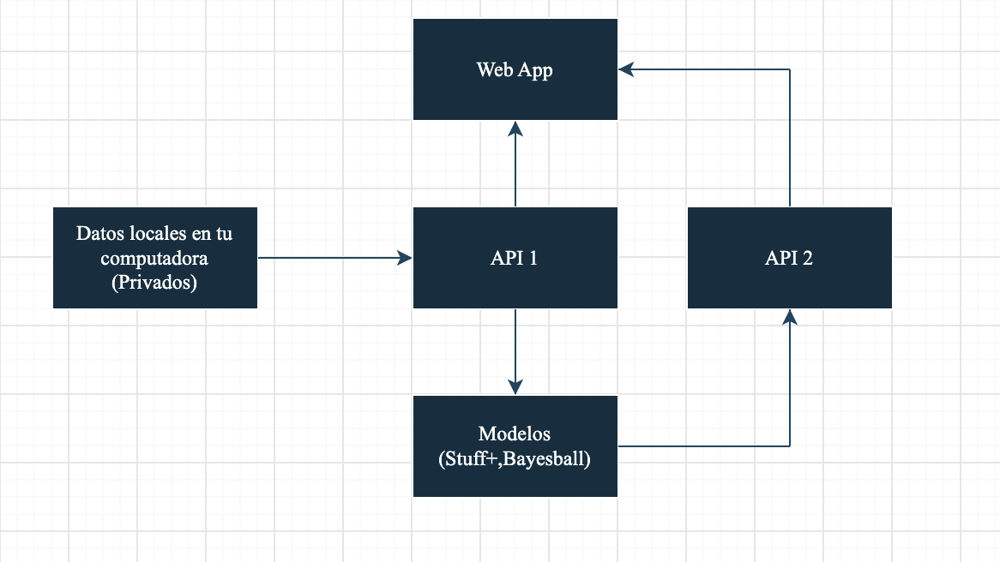

# Stuff+ ajustado por altitud — Diablos Rojos del México

**Hackathon ISAC 2026.** Un modelo que califica cada pitcheo de la Liga Mexicana de Beisbol y mide cuánto cambia su calidad en la altitud del Estadio Alfredo Harp Helú (CDMX, 2,240 m).

> **Escala:** `Stuff+ = 100 + 10 × z(score)`. 100 es el promedio de la LMB y cada 10 puntos es una desviación estándar.

## Equipo

| Nombre | GitHub |
|---|---|
| Fernando Arellano | [@FerArGo56](https://github.com/FerArGo56) |
| Arié Goldzweig | [@goldzweigarie-bit](https://github.com/goldzweigarie-bit) |
| Mikel Loret | [@loretmikel](https://github.com/loretmikel) |
| Meyer Hemilson | [@Meyer03](https://github.com/Meyer03) |

## Cómo está organizado

| Carpeta | Qué hay |
|---|---|
| [`apis/`](apis/) | Los dos APIs (datos y resultados) y los scripts para instalar y correr todo |
| [`modelos/`](modelos/) | Los dos modelos: **Stuff+** (XGBoost) y **BayesBall** (P(whiff) perceptual) |
| [`webapp/`](webapp/) | La web app que presenta los resultados: mapa de parques, perfiles de pitchers, bullpen y agentes libres |
| [`documento_tecnico/`](documento_tecnico/) | El paper del proyecto |

## Cómo fluyen los datos



1. Los datos de la competencia viven **en tu computadora**, fuera del repo. El **API 1** es lo único que los lee.
2. Los **modelos** piden los pitcheos al API 1 (GET) y suben sus resultados al **API 2** (POST).
3. La **web app** junta los pitcheos del API 1 y los resultados del API 2, y los muestra en el navegador.

## Correr todo

Antes, pon los datos de la competencia en `~/Desktop/hackathon/` (fuera del repo): `stuff_model_df.pkl` y `RunValueEvents.csv`.

Desde la raíz del repo:

| Paso | Comando | Cuándo |
|---|---|---|
| 1. Instalar | `bash apis/instalar.sh` | Una vez por computadora |
| 2. Prender | `bash apis/iniciar_todo.sh` | Cada vez. Abre la web app en http://localhost:8002 |
| 3. Correr los modelos | `bash apis/correr_modelos.sh` | En **otra** Terminal, con todo prendido. Solo la primera vez o cuando cambie un modelo |

El detalle de cada paso está en [`apis/README.md`](apis/README.md).

## Los entregables

| # | Entregable | Dónde está |
|---|---|---|
| 1 | Stuff+ por pitcheo, pitcher y arsenal | [`modelos/stuff_plus/`](modelos/stuff_plus/) (Pasos 7 y 8) y la web app |
| 2 | Perfil físico ideal para Diablos Rojos | [`documento_tecnico/`](documento_tecnico/) y [`webapp/`](webapp/) |
| 3 | Recomendaciones operativas | [`documento_tecnico/`](documento_tecnico/) y [`webapp/`](webapp/) |
| 4 | Dashboard simulador | [`webapp/`](webapp/) |
| 5 | Documento técnico | [`documento_tecnico/`](documento_tecnico/) |

## Hipótesis (de la convocatoria)

- **H1:** El aire ~20% menos denso reduce el quiebre por efecto Magnus en Harp Helú.
- **H2:** Los pitcheos basados en diferencia de velocidad (changeup) ganan Stuff+ relativo en altitud.
- **H3:** Los pitchers de rola valen más en altitud, porque hay menos riesgo de jonrón.
- **H4:** "Shape over label": el movimiento observado importa más que el spin rate por sí solo.

## Cómo trabajamos
`main` está protegida: **nadie sube cambios directo a `main`**. Todo cambio pasa por una rama y un Pull Request que aprueba otro compañero.

### 1. La primera vez: clonar el repo

```bash
git clone https://github.com/FerArGo56/diablos-rojos-WARROOM-stuffplus.git
```

### 2. Antes de empezar algo nuevo: actualizar `main` y crear tu rama

```bash
git checkout main
git pull
git checkout -b tipo/descripcion-corta
```

Nombres de rama según el tipo de cambio:

| Prefijo | Para qué | Ejemplo |
|---|---|---|
| `feat/` | Algo nuevo | `feat/modelos-desde-api1` |
| `fix/` | Arreglar un error | `fix/rangos-altitud` |
| `docs/` | Solo documentación | `docs/readme-webapp` |

### 3. Guardar y subir tus cambios

```bash
git add <archivos que cambiaste>
git commit -m "Qué cambiaste, en una frase"
git push -u origin tipo/descripcion-corta
```

### 4. Abrir el Pull Request

En GitHub aparece el botón **Compare & pull request**. Explica qué cambiaste y por qué, y pide revisión a un compañero.

### 5. Revisión y merge

- Un compañero revisa y aprueba. **Nadie puede aprobar su propio Pull Request.**
- Con la aprobación, se hace **Merge** en GitHub y se borra la rama.
- Después, todos actualizan su copia con `git checkout main` y `git pull`.

### Reglas

- **Antes de cada commit, borra las salidas de los notebooks** (Kernel → Restart & Clear Output). Muestran tablas sacadas de los datos.
- **Nunca uses `git add -f`.** El `.gitignore` bloquea datos y llaves por una razón.
- **Una rama por tarea.** Si son dos cosas distintas, son dos Pull Requests.

## Referencias

- Tango, Lichtman & Dolphin (2007). *The Book: Playing the Percentages in Baseball*.
- Huang & Hsu (2021). *Big data analytics in baseball: A review*. SAGE Open.
- SABR. *High Altitude Offense*. Baseball Research Journal.
- Alan Nathan. Física del béisbol: efecto Magnus y altitud.
